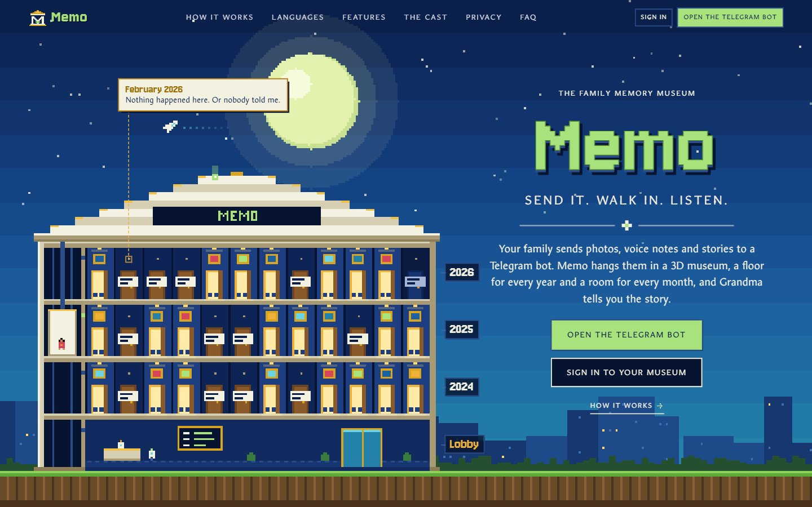
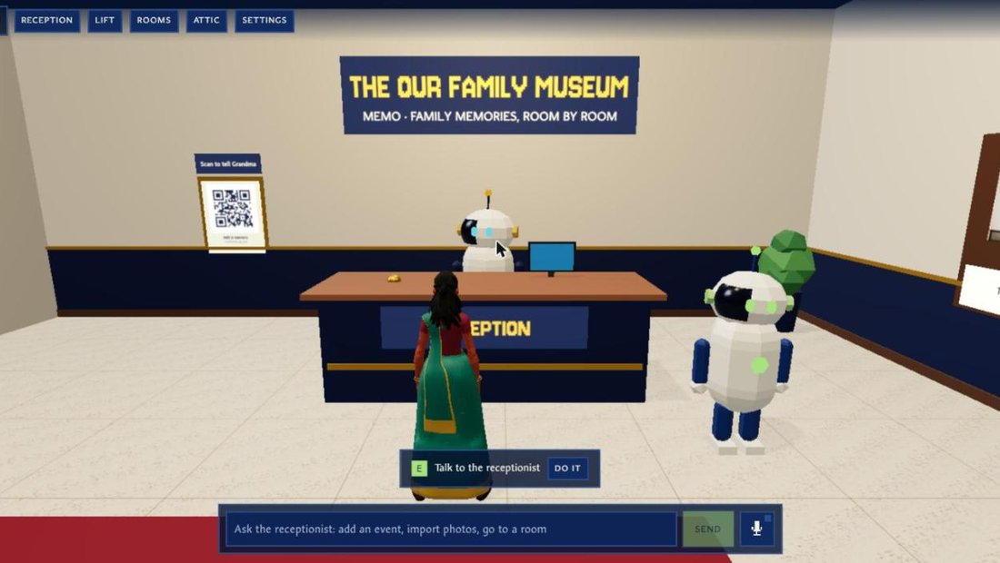
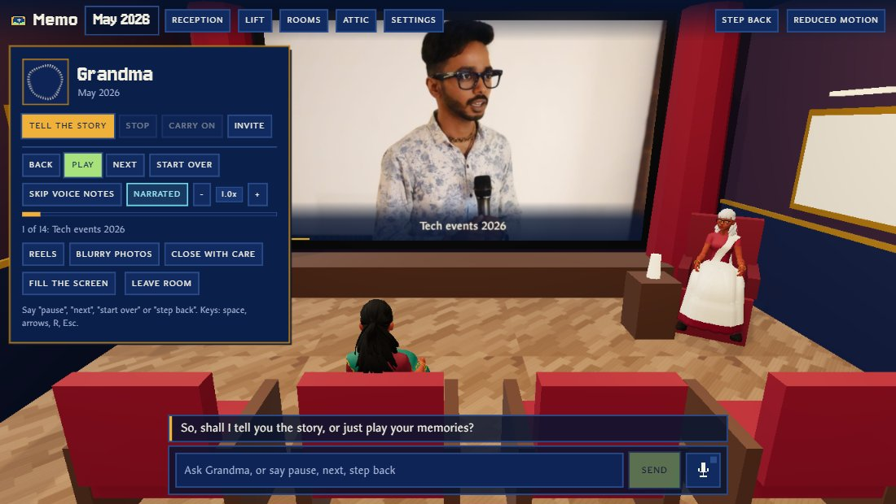
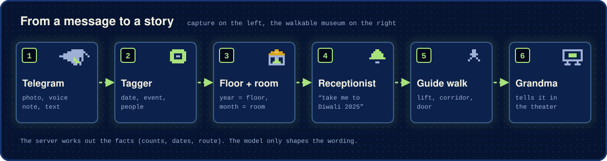

<p align="center"></p>

<p align="center">
  
  
  
  
  
  
  
</p>

<p align="center">
  <a href="#-what-is-memo"><b>What is Memo</b></a> &nbsp;·&nbsp;
  <a href="#%EF%B8%8F-how-it-works"><b>How it works</b></a> &nbsp;·&nbsp;
  <a href="#-voices-and-languages"><b>Voices</b></a> &nbsp;·&nbsp;
  <a href="#-run-it"><b>Run it</b></a>
</p>

<p align="center"></p>
<p align="center"><sub>The landing page. There is no live demo link: Memo runs on a local machine behind a Cloudflare tunnel.</sub></p>

<table>
  <tr>
    <td width="50%" align="center"></td>
    <td width="50%" align="center"></td>
  </tr>
  <tr>
    <td align="center"><sub><b>Reception.</b> Ask the receptionist robot for a room; the guide robot walks you there.</sub></td>
    <td align="center"><sub><b>The theater.</b> Grandma tells the month's memories as a story on the big screen.</sub></td>
  </tr>
</table>


## 🏛️ What is Memo

- **Send it.** Your family sends photos, voice notes and text to a Telegram bot (`@memo_ajji_bot`). Memo reads the date and the event and files each item.
- **Walk in.** The memories hang in a 3D museum. Each year is a floor, each month is a room, and a lift connects the floors.
- **Ask for anything.** A receptionist robot takes you where you say, by voice: "take me to Diwali 2025". A guide robot walks you there.
- **Listen.** In the theater, Grandma (Ajji, Dadi or Grandma) tells the memories as a story, in English, Hindi or Kannada, including Hinglish.




## ⚙️ How it works

Memo has two halves. **Capture** happens in Telegram: a message becomes a memory in the right room. **Visit** happens in the browser: you walk the museum, and every spoken request has a button that does the same thing.

**One spoken request, "take me to Diwali 2025":**



If more than one event matches, the receptionist asks one clarifying question before it plans a route.

**Floors and rooms.** The first year with memories is the ground floor beside the lobby; each later year is one floor up. Rooms are open, locked, not yet, empty, or closed with care. Memories with an unknown date wait in the attic, shown in the lobby.


## ✨ Features

<table>
  <tr>
    <td width="33%" valign="top">💬 <b>Telegram capture</b><br>Photos, voice notes and text. Memo transcribes voice, tags the date and event, and asks the family a follow-up when a story has a gap.</td>
    <td width="33%" valign="top">🏢 <b>A museum that fills itself</b><br>A floor per year, a room per month, a lift between floors, and an attic for undated memories.</td>
    <td width="33%" valign="top">🤖 <b>Robot receptionist</b><br>Add an event, import photos from a date, or go to a room. Counts and size are read back before anything is imported.</td>
  </tr>
  <tr>
    <td valign="top">🚶 <b>Guide robot</b><br>"Follow me." It rides the lift and walks you to the door. Skip it with a tap, a key, or by saying "skip".</td>
    <td valign="top">👵 <b>Grandma's theater</b><br>A tour of the room, or ask her questions. She answers from the room's memories and you can interrupt her at any time.</td>
    <td valign="top">📞 <b>Invite by phone call</b><br>A Twilio call invites a relative. They get a guest link, and when they join they appear in a seat beside you.</td>
  </tr>
  <tr>
    <td valign="top">🎞️ <b>Video reels</b><br>A room becomes an MP4 with ffmpeg: captioned photos, text cards and your voice notes, with optional Grandma narration.</td>
    <td valign="top">🧹 <b>Blurry photo cleanup</b><br>Photos are scored for blur. Review them and delete or keep. Reels can skip blurry photos.</td>
    <td valign="top">📱 <b>2D mode</b><br>A plain 2D view of the same museum for phones and machines that cannot run 3D.</td>
  </tr>
  <tr>
    <td valign="top">🗣️ <b>Three languages</b><br>English, Hindi and Kannada. Hinglish and Kanglish in, Hinglish and Kanglish out.</td>
    <td valign="top">🚩 <b>Feature flags</b><br>Self-hosted Flagsmith, per family, with segments and a 50/50 experiment.</td>
    <td valign="top">🐝 <b>AI-SRE alerts</b><br>Job failures, API errors, provider trouble and a stuck queue go to NudgeBee, with no personal data.</td>
  </tr>
</table>


## 🗣️ Voices and languages

Each character has one Sarvam bulbul:v3 speaker that stays the same across English, Hindi and Kannada, so a character keeps its voice when the language changes.

| Character | Speaker | Style |
|---|---|---|
| Grandma | `neha` + aged-voice chain | slow (pace 0.85), lower pitch, warm; story-teller |
| Receptionist | `priya` | crisp and upbeat |
| Guide robot | `rohan` | bright, short lines |
| Phone agent | `advait` | steady and measured for a phone line |

- **Aged voice.** No available voice is an elderly voice, so Grandma's clips go through an ffmpeg chain: slightly lower pitch, slower tempo, longer pauses, a slow pitch wobble, softer highs and a little breath. `GRANDMA_AGE_FX` sets `off`, `subtle` or `strong` (default `strong`).
- **Fallbacks.** If Sarvam is unavailable, speech falls back to Murf voices; the language model falls back from Sarvam to Groq.
- **Hinglish.** Replies mirror the visitor: Hinglish in, Hinglish out; Kanglish in, Kanglish out; native script in, native script out. Roman-script text is voiced with the Hindi or Kannada voice.
- **One speaker at a time.** A single arbiter in the browser (`web/src/voice/speechArbiter.ts`) decides who may speak: agent, then guide, then short filler clips. A lower-priority claim is dropped, so voices never overlap.
- **Barge-in.** When you speak, type, or press the mic, everyone stops, queued sentences are dropped and the in-flight request is aborted.
- **Live voice.** In-room conversation runs through Agora Conversational AI, with a browser-side voice path as the fallback.


## 🚩 Flagsmith (feature flags)

Every runtime switch is read with `await flags.get(key, family_id)` in [backend/app/flags.py](backend/app/flags.py). Flagsmith is one layer of that lookup and never a hard dependency.

**Resolution order:**

```
flag_overrides row for the family -> global flag_overrides row -> Flagsmith -> flags.DEFAULTS
```

- **Local evaluation.** The Flagsmith Python SDK downloads the environment in a background thread and evaluates segments in memory, so reading a flag makes no network call. Values are cached for 30 s, so a dashboard change shows up within about a minute.
- **Identity** is the `family_id`, with traits read from Postgres: `language`, `member_count`, `created_days_ago`, `has_phone_invites`, `has_call_consent`.
- **Falls back safely.** With no `FLAGSMITH_ENVIRONMENT_KEY`, or with the server down, database overrides and the code defaults apply.
- **What is flagged:** `museum_3d`, `voice_enabled`, `barge_in`, `cinematic_walk`, `video_reels`, `auto_skip_blurry`, `phone_calls_enabled`, `max_calls_per_day`, `phone_allowlist`, `proactive_followups`, `followup_variant`, `max_followups_per_week`, `llm_model`, `tts_voice_by_language`, `general_knowledge`, `max_import_photos`, `sarcasm_enabled`, `nudgebee_alerts`.

| Segment or experiment | Rule | Effect |
|---|---|---|
| `phone_pilot` | `family_id` is in `FLAGSMITH_PHONE_PILOT_FAMILIES` | turns `phone_allowlist` on in Production |
| `hindi_or_kannada` | `language` is `hi-IN` or `kn-IN` | sets `tts_voice_by_language` for those families |
| `followup_variant` | multivariate, `a` 50 % and `b` 50 % | sticky per family |

**Run it self-hosted** (about 300 MB RAM, its own `flagsmith` database on the same Postgres):

```powershell
docker compose --env-file .env.local --profile flags up -d flagsmith   # dashboard on http://localhost:8001
cd backend; .venv\Scripts\python scripts\flagsmith_seed.py              # idempotent: project, environments, features, segments
```

The seed writes `FLAGSMITH_ENVIRONMENT_KEY` and `FLAGSMITH_API_URL` into `.env.local`. Restart the API and worker afterwards. The Operator panel shows which layer each flag came from.


## 🐝 NudgeBee (AI-SRE)

Memo posts its own incidents to NudgeBee's Generic Event Webhook so NudgeBee can group them, dedupe them and run root-cause analysis. NudgeBee also has the GCP project and a local Kubernetes cluster agent connected.

One `firing` event is sent per problem (re-sent at most every 5 minutes while open) and a `resolved` event follows when it recovers. Events are batched and posted in the background with a 3 s timeout; a failure to reach NudgeBee never affects a request.

| Signal | Fires when | Resolves when |
|---|---|---|
| `job_failed` | a job kind fails 3+ times, or exhausts its retries | the same job kind succeeds |
| `api_5xx` | an unhandled exception or 5xx on a route (route template) | that route answers without a 5xx |
| `provider_degraded` | 5+ errors in 5 minutes from Sarvam, Groq, Murf, Twilio, Telegram or Agora | 3 successes in a row |
| `queue_backlog` | the oldest runnable job waited more than 10 minutes | the queue drains |
| `db_unreachable` | the worker watchdog cannot run `SELECT 1` | the database answers again |

**Privacy.** Never sent: names, phone numbers, emails, memory text, transcripts, exception messages, raw URLs. Descriptions hold only a job kind, a route template or an exception class, and digit runs and email-like strings are redacted as a backstop. Labels come from a fixed allow-list (an opaque family UUID appears on job events only).

**Setup.** Create an Event Webhook integration in NudgeBee, then set `NUDGEBEE_WEBHOOK_URL`, `NUDGEBEE_TOKEN` and optionally `MEMO_ENV` in `.env.local`. Check it with `cd backend; .venv\Scripts\python scripts\nudgebee_test_event.py`. Turn it off with the `nudgebee_alerts` flag or by unsetting the variables.


## 🧱 Architecture



| Piece | Where |
|---|---|
| Telegram capture, commands, follow-ups | `backend/app/telegram/`, `backend/app/tasks/capture.py`, `followups.py` |
| Tagger, STT, TTS, LLM chain | `backend/app/ai/` |
| Dates, floors, rooms, routing | `backend/app/core/` |
| Receptionist, Grandma, Agora config | `backend/app/voice/` |
| Phone invites and call flow | `backend/app/phone/`, `backend/app/routes/twilio.py` |
| Reels and blur detection | `backend/app/media/` |
| Postgres job queue (`SKIP LOCKED`) and live events | `backend/app/jobs.py`, `bus.py`, `routes/stream.py` |
| Feature flags | `backend/app/flags.py`, `backend/scripts/flagsmith_seed.py` |
| NudgeBee incidents | `backend/app/observability/nudgebee.py` |
| 3D museum, robots, theater | `web/src/world/` |
| Landing, HUD, panels, 2D mode | `web/src/pages/` |
| Voice controller and arbiter | `web/src/voice/` |


## 🚀 Run it

On Windows with Docker Desktop, Python 3.12, Node 20+ and `cloudflared` (for the public tunnel).

1. **Database.** Start Postgres 16 (on `localhost:5433`):
   ```powershell
   docker compose up -d
   ```
2. **Keys.** Copy `.env.example` to `.env.local` and fill it in.
3. **Backend.**
   ```powershell
   cd backend
   python -m venv .venv
   .venv\Scripts\python -m pip install -r requirements.txt
   ```
4. **Web.**
   ```powershell
   cd web; npm install
   ```
5. **Start everything:**
   ```powershell
   .\start-memo.ps1
   ```
   It starts Postgres, opens a Cloudflare tunnel and writes its URL into `.env.local` as `PUBLIC_BASE_URL` and `WEB_BASE_URL` (Twilio and Agora call back to it), then starts the API on `:8000`, the worker, the Telegram bot in long-polling mode and the web app on `:5173`. Send `/start` to the bot, then `/museum` for a sign-in link.

<details>
<summary><b>Environment variables</b> (names only, see <code>.env.example</code>)</summary>

| Group | Variables |
|---|---|
| Language and voice | `SARVAM_API_KEY`, `GROQ_API_KEY`, `MURF_API_KEY`, `MURF_REGION`, `LLM_PROVIDER`, `GRANDMA_AGE_FX` |
| Agora | `AGORA_APP_ID`, `AGORA_APP_CERTIFICATE`, `AGORA_CUSTOMER_ID`, `AGORA_CUSTOMER_SECRET` |
| Telegram | `TELEGRAM_BOT_TOKEN`, `TELEGRAM_WEBHOOK_SECRET`, `TELEGRAM_MODE`, `TELEGRAM_REGISTER_WEBHOOK` |
| Twilio | `TWILIO_ACCOUNT_SID`, `TWILIO_AUTH_TOKEN`, `TWILIO_VOICE_FROM` |
| App | `DATABASE_URL`, `APP_SECRET`, `PUBLIC_BASE_URL`, `WEB_BASE_URL`, `STORAGE_DIR`, `GALLERY_DIR`, `DEFAULT_TZ`, `RUN_WORKER_IN_PROCESS`, `WEB_DIST_DIR` |
| Flagsmith | `FLAGSMITH_ENVIRONMENT_KEY`, `FLAGSMITH_API_URL`, `FLAGSMITH_DJANGO_SECRET_KEY`, `FLAGSMITH_ADMIN_EMAIL`, `FLAGSMITH_ADMIN_PASSWORD`, `FLAGSMITH_ADMIN_API_KEY`, `FLAGSMITH_PHONE_PILOT_FAMILIES` |
| NudgeBee | `NUDGEBEE_WEBHOOK_URL`, `NUDGEBEE_TOKEN`, `MEMO_ENV`, `NUDGEBEE_BACKLOG_MIN` |

</details>


## 🧪 Tests

```powershell
cd backend; .venv\Scripts\python -m pytest -q
```


## 📁 Project layout

```
backend/
  app/            FastAPI app: routes/, core/, ai/, voice/, telegram/, phone/, media/, tasks/,
                  observability/, flags.py, jobs.py, bus.py, schema.sql
  scripts/        flagsmith_seed.py, nudgebee_test_event.py, voice measurement tools
  tests/          pytest suite
web/
  src/            world/ (3D), pages/ (landing, HUD, 2D), voice/, state/, api/
  public/         brand assets and the museum's character models
media/readme/     images used by this README
docker-compose.yml, start-memo.ps1
```


## 🙏 Credits and licences

- Everything in the museum (building, doors, lift, theater, signage, robots, textures) is generated in code. The player and Grandma characters use local model files, listed in [web/public/assets/CREDITS.md](web/public/assets/CREDITS.md).
- **The saree model (the woman player and Grandma) is CC BY-NC 4.0**, from a Ready Player Me avatar via TalkingHead. It is for non-commercial use only; replace it with a commercially licensed mesh before any commercial launch.
- The animation source and the male model come from the three.js examples (Mixamo and Ready Player Me terms); see the credits file for details.
- Voices by Sarvam (bulbul) and Murf; live voice by Agora; phone by Twilio; flags by Flagsmith; incident handling by NudgeBee.

---

<p align="center">
  <b>Memo</b>, your family's memories, a museum you can walk through<br>
  <sub>Photos, voice notes and stories in. A museum you can walk through, out.</sub>
</p>
